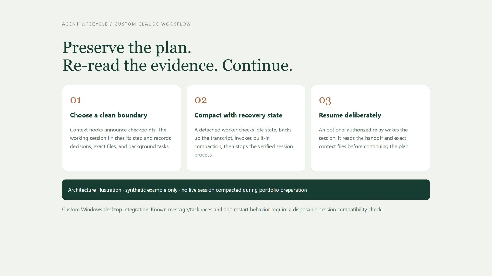
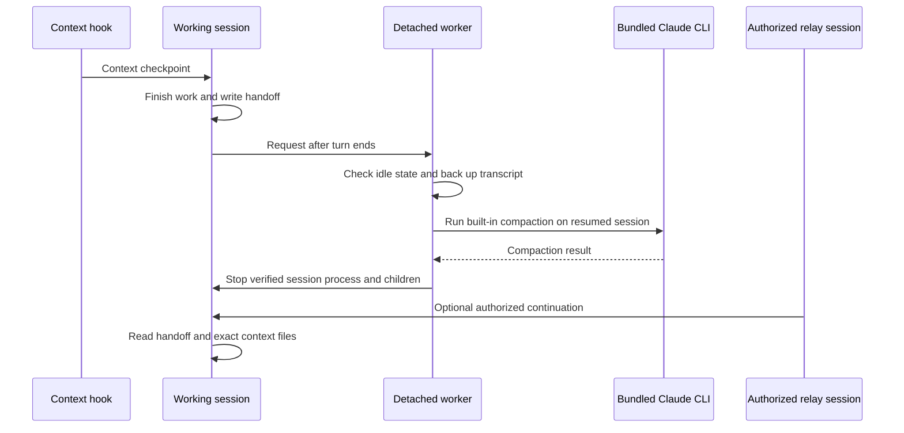

# Claude Self-Compaction

## Project explanation

[Read the case study](https://kobin-ai-portfolio.kobinkempe.chatgpt.site/case-studies/claude-self-compaction/)

A custom Windows Claude Code desktop workflow that gives a long-running agent control over when it compacts, so its human operator does not have to supervise context resets.



## The business case: remove a supervision bottleneck

> AI can do so much. Why can’t it decide when to compact, what context to preserve, and how to hand off its own work?

Claude could not invoke compaction at a point it chose. That left two operational choices: watch a long-running task and manually tell it when to compact, or let automatic compaction happen at a token threshold that might fall in the middle of work that depended on the current context.

This skill gives the agent explicit control over that boundary. It chooses a convenient stopping point, preserves important state in a handoff, performs compaction, re-reads the necessary context, and resumes its own plan. Context management becomes part of the agent's work instead of a recurring human monitoring task.

**Outcome in the author's use:** this enabled a multi-week task to run entirely unsupervised, with the agent compacting itself without losing important context. This is the author's reported project outcome, not a general reliability benchmark across models or desktop versions.

## What preserves continuity

Checkpoints help the agent plan ahead without forcing an immediate reset. The handoff records the goal, decisions, current state, background work and exact files to re-read. The resumed agent uses those source files rather than treating a lossy summary as a copy of them.

## Design



The ordering matters: compact before stopping the desktop process, because the app may restart it immediately. Per-session state, stale-request checks, backups and atomic JSON writes support recovery. Optional kept shell tasks need explicit tracking after resume. Full design notes and historical observations are in [docs/ORIGINAL_DESIGN.md](docs/ORIGINAL_DESIGN.md).

## Review without installing

Python 3.10+; the script uses the standard library.

```sh
python selfcompact.py --help
python -m unittest discover -s tests
```

These checks do not compact a real conversation or stop a process. The included tests use only synthetic transcript and process metadata. Live compaction, WMI detachment, process termination and the relay have not been executed during portfolio preparation.

## Installation is explicit

This repository does not install itself. The real workflow changes global hooks and can stop a session's process tree. Read [INSTALL.md](INSTALL.md), set the script path, review the settings fragment, authorize a relay in its own chat if wanted, and test in a disposable session before enabling it broadly. Never copy actual settings.json, transcripts, archived sessions, hook logs or relay state into a public repo.

## Boundaries

This is a custom integration based on observed desktop/CLI behavior, not an official Claude feature. Default thresholds assume a 1M-token context and must be adapted to the chosen model. A message or background task arriving during compaction can race with the old process; the app can display a crash/retry card. The script does not prove that a handoff is complete or that a relay message is authorized. Compatibility with current Claude versions remains to be tested.

The portfolio contribution is removing a human supervision bottleneck from long-running agent work through explicit compaction control, durable state and recovery. [Publication review](PUBLICATION_REVIEW.md).
