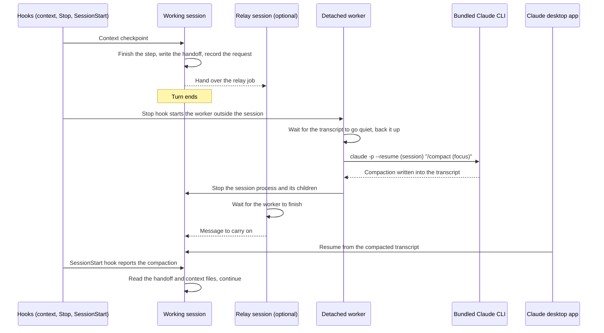

# Claude Self-Compaction

## Project explanation

[See project details](https://kobinkempe.pages.dev/projects/claude-self-compaction/)

A custom Windows Claude Code desktop workflow that gives a long-running agent control over when it compacts, so its human operator does not have to supervise context resets.


## The business case: remove a supervision bottleneck

> Claude Code can’t choose when to compact its own context. This tool lets the agent pick a clean stopping point, save what it needs and carry on by itself.

Claude could not invoke compaction at a point it chose. That left two operational choices: watch a long-running task and manually tell it when to compact, or let automatic compaction happen at a token threshold that might fall in the middle of work that depended on the current context.

This skill gives the agent explicit control over that boundary. It chooses a convenient stopping point, preserves important state in a handoff, performs compaction, re-reads the necessary context, and resumes its own plan. Context management becomes part of the agent's work instead of a recurring human monitoring task.

**Outcome in my use:** this enabled a multi-week task to run entirely unsupervised, with the agent compacting itself without losing important context.

That task supported [bound.less](https://github.com/kobinkempe/bound.less-kk): reviewing and hardening an already-built custom rasterizer that was initially brittle, then analyzing, researching and implementing performance improvements. Compaction control let the agent choose a coherent stopping point between steps and carry its plan forward through repeated context resets.

## What preserves continuity

Checkpoints help the agent plan ahead without forcing an immediate reset. The handoff records the goal, decisions, current state, background work and exact files to re-read. The resumed agent uses those source files rather than treating a lossy summary as a copy of them.

## Design



The ordering matters: compact before stopping the desktop process, because the app may restart it immediately. The app resumes the session from the compacted transcript right away if it is on screen, otherwise when the next message (such as the relay's) arrives. Per-session state, stale-request checks, backups and atomic JSON writes support recovery. Optional kept shell tasks need explicit tracking after resume. Full design notes and historical observations are in [docs/ORIGINAL_DESIGN.md](docs/ORIGINAL_DESIGN.md).

## Review without installing

Python 3.10+; the script uses the standard library.

```sh
python selfcompact.py --help
python -m unittest discover -s tests
```

These checks do not compact a real conversation or stop a process; the included tests use only synthetic transcript and process metadata. The full workflow, including live compaction, process handling and the relay, is in regular use in my own Claude desktop sessions on Windows.

## Download and guided installation

[Download the Windows install package](https://github.com/kobinkempe/claude-self-compaction/releases/download/v0.1.0/claude-self-compaction-windows.zip) from [GitHub Releases](https://github.com/kobinkempe/claude-self-compaction/releases/tag/v0.1.0). Extract it and run **INSTALL.cmd** (Python 3.10+), or run `python install.py`. Nothing runs merely by downloading.

The wizard explains the 1M-context defaults (250K at a hard pivot, ordinary work around 500K, later checkpoints for context-heavy work), then asks whether to change thresholds, rules or handoff preferences. It generates both the runtime JSON policy and the installed SKILL.md from the same choices. Re-run it with `--configure` to change them later.

**Sign in to BOTH Claude Desktop and the Claude Code CLI.** Desktop login alone is insufficient. **Set up a separate, explicitly authorized relay chat with Desktop cross-session messaging** for automatic continuation. The installer explains both requirements and leaves the integration disabled if setup is deferred. GitHub CLI login is not required to use the ZIP.

The wizard preserves unrelated hooks/settings and creates backups. It never compacts, stops a process or sends a message during installation. Read the [step-by-step installation guide](INSTALL.md) for relay setup, testing, customization and rollback. This remains a custom Windows Desktop integration; a terminal-only skill does not supply its process and messaging capabilities.

## Boundaries

This is a custom integration based on observed desktop/CLI behavior, not an official Claude feature. Default thresholds assume a 1M-token context and must be adapted to the chosen model. A message or background task arriving during compaction can race with the old process; the app can display a crash/retry card. The script does not prove that a handoff is complete or that a relay message is authorized. It works with the current Claude desktop app and CLI; future app updates could change the behavior it relies on.

The portfolio contribution is removing a human supervision bottleneck from long-running agent work through explicit compaction control, durable state and recovery.
